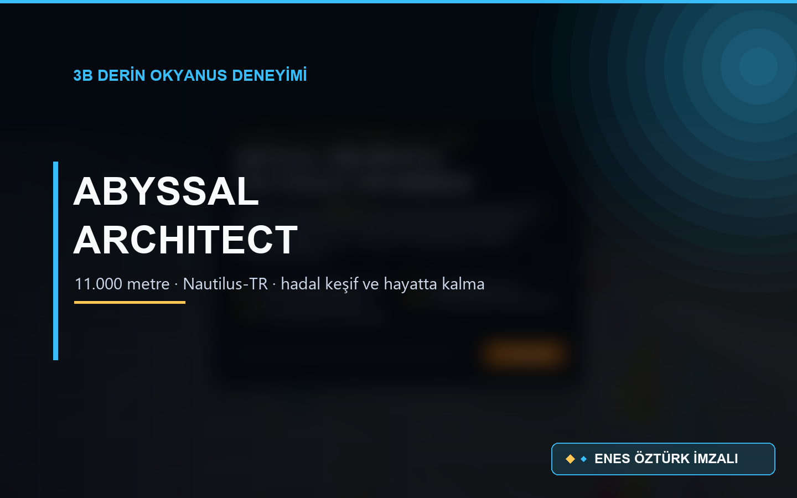
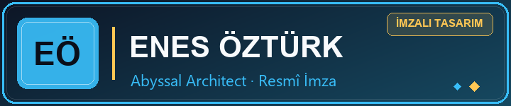
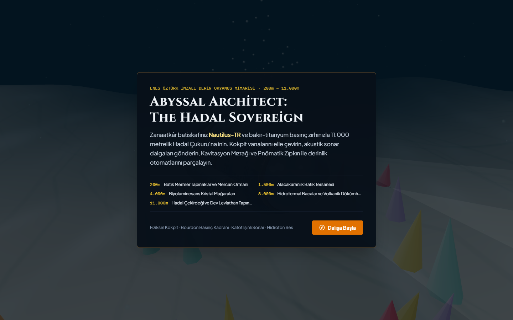
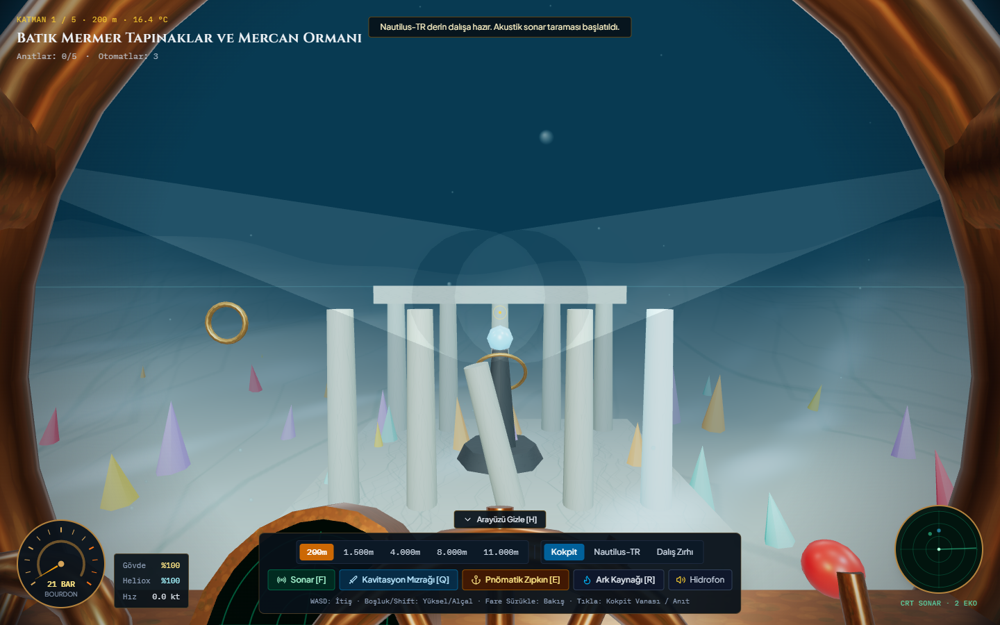
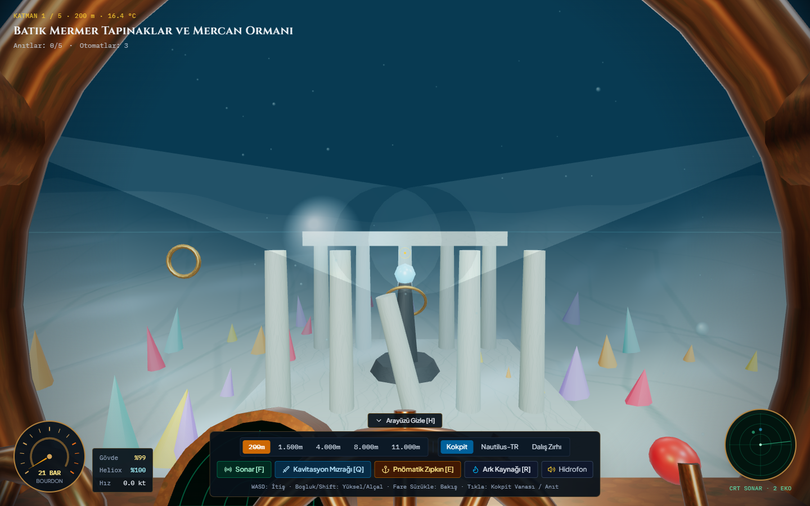

<div align="center">



# Abyssal Architect: The Hadal Sovereign

**Enes Öztürk imzalı, Nautilus-TR batiskafıyla 200 metreden 11.000 metreye inen 3B derin okyanus keşif ve hayatta kalma deneyimi.**

[](https://github.com/EnesBinMalik/abyssal-architect-hadal-sovereign)
[](https://react.dev/)
[](https://www.typescriptlang.org/)
[](https://threejs.org/)
[](https://vite.dev/)

[](https://github.com/EnesBinMalik)
[](https://github.com/EnesBinMalik/abyssal-architect-hadal-sovereign)
[](https://github.com/EnesBinMalik/abyssal-architect-hadal-sovereign)
[](https://github.com/EnesBinMalik/abyssal-architect-hadal-sovereign)



</div>

---

## Hakkında

**Abyssal Architect**, basınç bir sayı değil; gövdenizi ezmeye çalışan gerçek bir düşman olduğu bir dünyada geçen birinci şahs 3B su altı deneyimidir. Bakır-titanyum zırhlı Nautilus-TR'nin kokpit vanalarını elle çevirir, Bourdon manometresini izler, katot ışınlı sonarınızla karanlığı tararsınız.

Beş derinlik katmanı; batık mermer tapınaklarından hidrotermal bacalara, biyolumesans kristal mağaralardan Hadal Çekirdeği'ndeki dev Leviathan tapınağına kadar uzanır. Her katman kendi basınç, sıcaklık, görüş mesafesi ve düşman ekosistemiyle ayrı bir fizik deneyidir. Tüm sahne, su efektleri ve araç modellemesi **Three.js** ile prosedürel olarak üretilmiştir.

> Bu proje **Enes Öztürk** tarafından tasarlanmış, geliştirilmiş ve imzalanmıştır.

---

## Öne çıkan özellikler

| Özellik | Açıklama |
| --- | --- |
| **5 derinlik katmanı** | 200 m mercan ormanından 11.000 m Hadal Çekirdeği'ne kadar ilerleyen bölüm yapısı. |
| **Fiziksel kokpit** | Açılır vanalar, ana sigorta, projektörler ve kaynak aletiyle gerçek sistem yönetimi. |
| **Bourdon manometresi** | Basınç, gövde bütünlüğü, heliox reservesı ve hız diegetik kadranlarda okunur. |
| **Katot ışınlı sonar** | `F` tuşuyla gönderilen akustik darbe, yakındaki anıtları ve otomatları ekrana vurur. |
| **Kavitasyon Mızrağı** | `Q` ile suyu patlatarak yakın mesafedeki otomatları parçalayan silah. |
| **Pnömatik zıpkın** | `E` ile hedefe kilitlenip batiskafı ileri çeken kurtarma ve saldırı aracı. |
| **Hidrofon ses motoru** | Derinlik arttıkça değişen akustik uğultu, sonar yankısı ve mekanik vana sesleri. |
| **İki görünüm modu** | Kokpit içi diegetik görünüm ve sinematik dış kamera arasında anlık geçiş. |

---

## Derinlik katmanları

| Katman | Derinlik | Bölge |
| --- | --- | --- |
| 01 | 200 m | Batık Mermer Tapınaklar ve Mercan Ormanı |
| 02 | 1.500 m | Alacakaranlık Batık Tersanesi |
| 03 | 4.000 m | Biyoluminesans Kristal Mağaraları |
| 04 | 8.000 m | Hidrotermal Bacalar ve Volkanik Dökümhane |
| 05 | 11.000 m | Hadal Çekirdeği ve Dev Leviathan Tapınağı |

Her bölge kendi fizik kuralları, ışıklandırması, dokusu ve akustik karakteriyle ayrı bir deneyim sunar.

---

## Kontroller

| Tuş | Aksiyon |
| --- | --- |
| `W` `A` `S` `D` | İtiş ve yönlendirme |
| `Boşluk` / `Shift` | Yüksel / alçal |
| `Fare` (sürükle) | Bakış açısı |
| `F` | Akustik sonar darbesi |
| `Q` | Kavitasyon Mızrağı |
| `E` | Pnömatik zıpkın |
| `H` | Arayüzü gizle / göster |
| `1` - `5` | Derinlik katmanı seçimi |

> Savaş sırasında arayüz tamamen kaldırılabilir: ekranda yalnızca dünya içi telemetri kalır.

---

## Galeri







---

## Kurulum

**Gereksinimler:** Node.js 20+ ve modern bir WebGL tarayıcı.

```bash
git clone https://github.com/EnesBinMalik/abyssal-architect-hadal-sovereign.git
cd abyssal-architect-hadal-sovereign
npm install
npm run dev
```

Uygulama varsayılan olarak `http://localhost:3000` adresinde açılır.

> Oyun tamamen istemci tarafında çalışır; `.env.example` yalnızca AI Studio dağıtım şablonu içindir.

Diğer komutlar:

```bash
npm run build     # Üretim derlemesi (dist/)
npm run preview   # Derlemeyi yerelde önizle
npm run lint      # TypeScript tip kontrolü
```

---

## Teknik mimari

```text
src/engine/AbyssEngine.ts        Ana oyun döngüsü, fizik ve kamera
src/engine/nautilusBuilder.ts   Prosedürel batiskaf modeli
src/engine/worldBuilder.ts      Derinlik katmanları ve anıtlar
src/engine/proceduralTextures.ts  Su, kaya ve metal dokuları
src/audio/HydrophoneAudio.ts    Hidrofon ses sentezi
src/components/ControlDock.tsx  Katman ve sistem kontrol paneli
src/components/DiegeticInstruments.tsx  Kokpit kadranları
```

---

## İmza

<div align="center">

[](https://github.com/EnesBinMalik)
[](https://github.com/EnesBinMalik)

**Bu kod, tasarım ve deneyim Enes Öztürk'ün kişisel imzasını taşır.**

© 2026 Enes Öztürk — Tüm hakları saklıdır.

</div>
